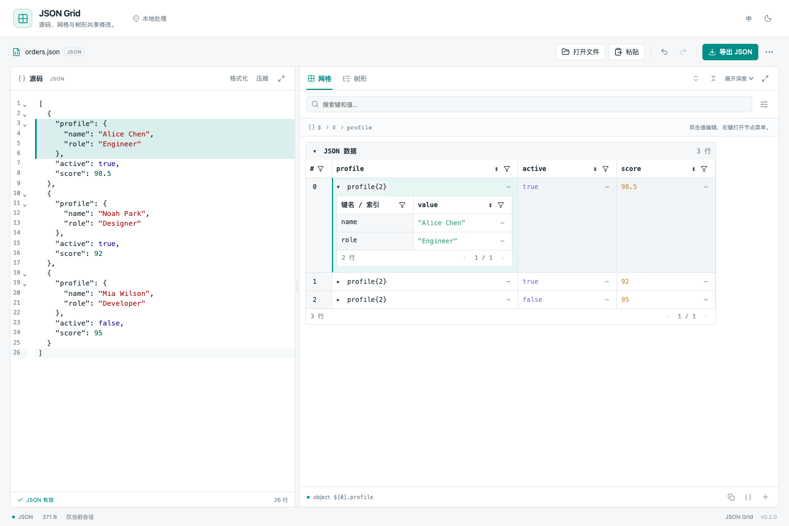
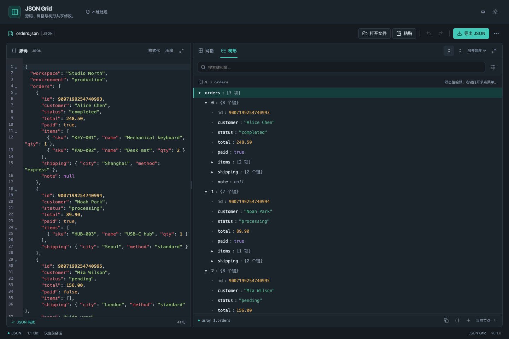

# JSON Grid for DBX

[](https://github.com/Ryn-Mic/dbx-json-grid/actions/workflows/ci.yml)
[](LICENSE)

一个运行在 **DBX 内部**的本地 JSON 工作台：可编辑嵌套网格、DevTools 风格树形、源码三种视图共享同一份文档。

A local JSON workbench inside DBX. Editable nested grids, a DevTools-style tree and a source editor share one lossless document and undo history.



## 功能 / Features

- **嵌套网格**：对象数组转行列，字段取并集；对象、基础数组、混合数组与根值均可查看。复杂单元格使用 `键名[数量]` / `键名{键数}` 单次展开，子表撑大父列并推动后续列。
- **可编辑树形**：虚拟列表、类型颜色、对象摘要与数组长度。双击或 Enter/F2 行内编辑值和字段名；菜单支持新增、删除和类型修改。数组列头重命名作用于所有行，冲突时整次拒绝。
- **源码联动**：点击网格或树中的字段，对应源码行高亮；选择对象或数组时覆盖整个块，保留原始路径和数字精度。
- **JSONPath**：复制节点路径、键或 JSON；特殊键正确转义，筛选与排序后保留原始数组下标。
- **搜索与筛选**：搜索键和值、命中计数与前后导航；树形保留祖先，列筛选默认收起为图标，支持包含/等于/数值比较和稳定排序。
- **视图状态**：切换网格/树形时分别恢复展开、选中、搜索、列筛选、排序、列宽、分页与滚动位置。暂时无效的源码不清空视图状态，换文件或 Host 工作区时重置；仅在当前工作台会话内保留。
- **展开与导航**：全部展开/折叠、指定深度、Alt+点击处理子树、选中路径导航、分页与分栏最大化。中线拖动分配两区宽度，包含窄索引列在内的所有列均可拖动宽度。
- **JSON 工具**：格式化、压缩、校验、解析 JSON 字符串、转为 JSON 字符串、文件打开/拖入/导出、当前子树导出。
- **数据完整性**：保留超出安全整数范围的数字与原始数字字面量；区分缺失字段和 null；拒绝重复键。无效源码原样保留并暂停结构化编辑。
- **DBX 适配**：明暗主题 tokens、中英文、Host 剪贴板/文件 API；可选小草稿恢复。所有依赖打包在插件内，无网络请求与原生 Sidecar。



## 安装 / Install

从 [Releases](https://github.com/Ryn-Mic/dbx-json-grid/releases) 下载 universal `.dbxp`。在 DBX 的「插件中心 → 设置 → 安装 .dbxp」安装，再从插件入口打开 **JSON Grid**。

当前 Release 是未签名审核候选包。手动测试需要在 DBX 插件设置中显式启用「允许安装未签名开发包」。官方商店需维护者审核、签名并合并登记；提交申请不等于已经上架。

The universal package runs on supported DBX desktop/web hosts. The UI targets Host API major 1; optional capabilities are detected at runtime. On older hosts, unavailable Paste/native save/draft controls disable. Source keyboard paste and basic editing remain available. See [acceptance and limits](docs/acceptance.md).

## 开发 / Develop

Requires Node.js 22.12+ (CI uses Node 24). Use the pinned CLI in `devDependencies`.

```sh
npm ci
npm run dev           # standalone UI at http://127.0.0.1:5173
npm run dbx:dev       # official opaque-origin development host, port 5190
npm test             # unit/component tests
npm run check        # TypeScript + tests + build + package contract
npx playwright install chromium
npm run test:browser # actual Chromium and official dev-host integration
npm run package      # build and unsigned universal .dbxp
npm run release:metadata
```

`npm run build:watch` emits `DBX_UI_BUILD_SUCCESS` only after a successful written Vite bundle, as required by the DBX dev host. Release assets contain only `manifest.json`, `assets/` and static `ui/` resources. Generated `ui/`, `dist/`, `.dbx-dev/`, dependencies and local development state are ignored by Git.

## 权限与数据 / Permissions and data

| Permission | Use |
|---|---|
| `host.storage` | Layout/preferences and explicitly enabled small drafts. Does not store a document by default. |
| `host.clipboard:read` | User-triggered Paste button where supported; keyboard paste is always available in the editor. |

Copying uses the Host bridge without a read permission. File operations use user-selected Host file handles or the browser file picker in preview. JSON never leaves the local app. No database access, AI integration, external service, telemetry, native executable or network origin permission is included.

Limits: 10 MiB input, depth 256, a 5,000-node display budget, 50 grid rows per page, bounded schema projection and opt-in small drafts. These are display/safety limits, not a claim of unlimited large-file support.

## 发布与商店发现 / Release and marketplace discovery

- Public repository: `Ryn-Mic/dbx-json-grid`; license: MIT.
- Stable plugin ID: `io.github.ryn-mic.json-grid`; publisher: `ryn-mic`.
- Pushing a matching `v<manifest.version>` tag runs checks and publishes an immutable unsigned candidate Release.
- Release assets: `.dbxp`, `.artifact.json`, `release-candidates.json` and `SHA256SUMS`.
- `.dbx-store.json` supplies bilingual listing metadata and the icon. Register this repository with `autoUpdate: true` in DBX Store's `automation/plugin-sources.json` for release discovery.
- First submission also includes `publishers/ryn-mic.json` and `candidates/io.github.ryn-mic.json-grid.json` in one DBX Store PR. The official signing workflow generates catalog entries; they are never hand-edited here.

[DBX plugin development](https://dbxio.com/cn/docs/plugin-development) · [DBX Store contribution guide](https://github.com/t8y2/dbx-store/blob/main/CONTRIBUTING.md)

## License

[MIT](LICENSE). Bundled runtime dependency licenses are included in `assets/THIRD_PARTY_NOTICES.txt`. The grid interaction is inspired by JsonGrid; this is an independent implementation.
